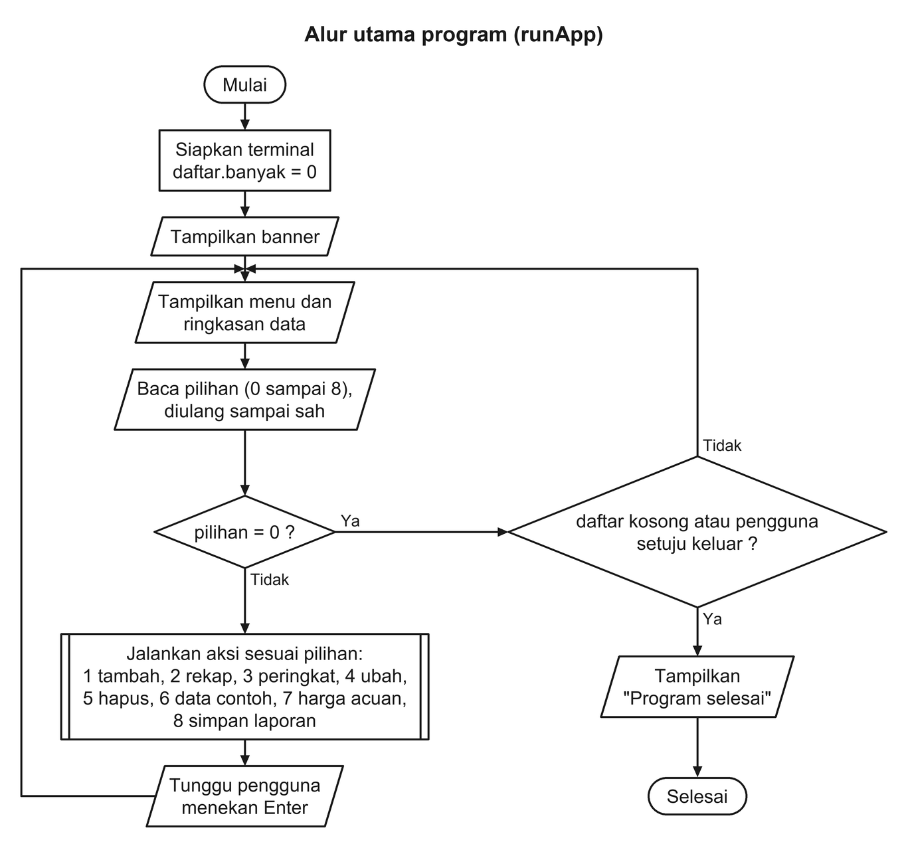
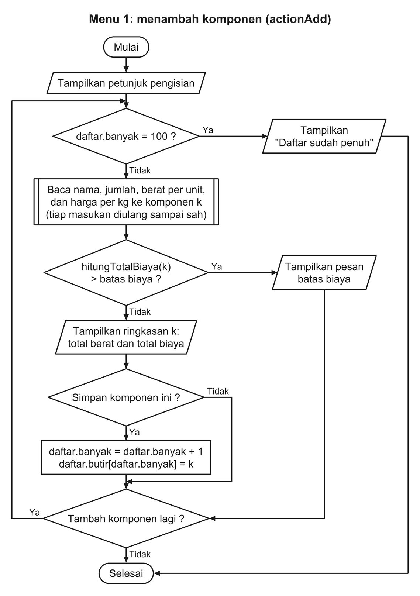
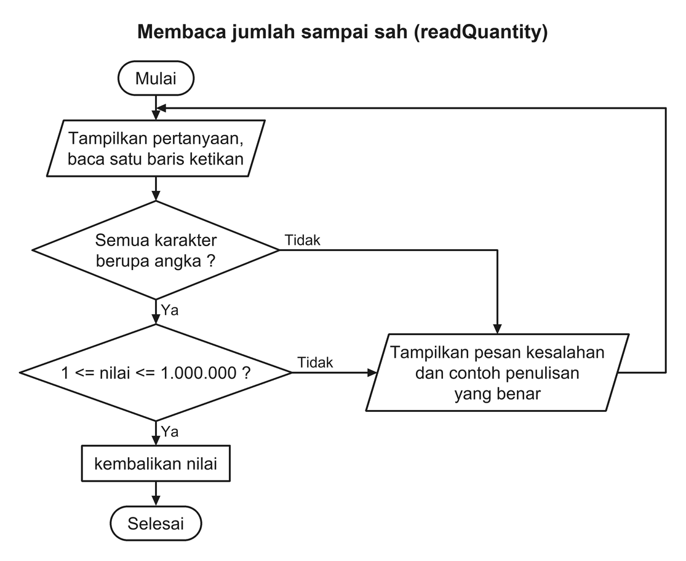
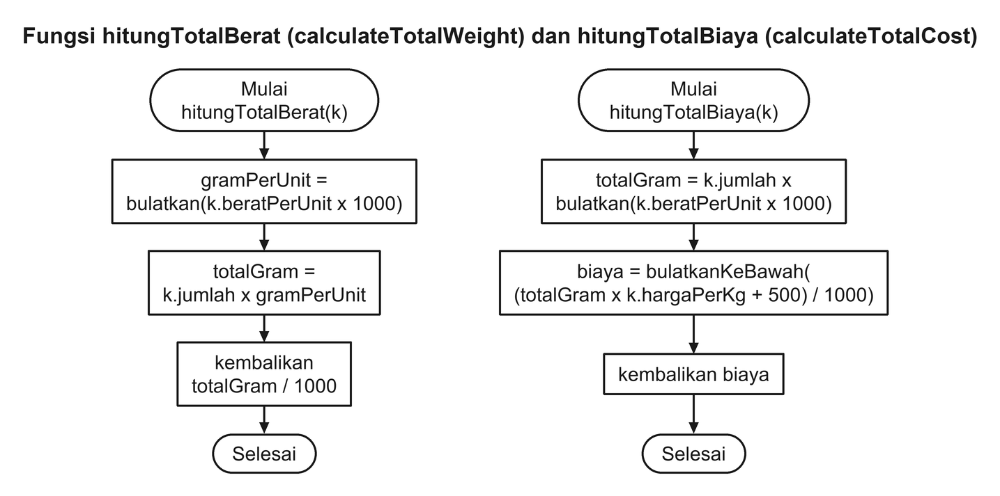
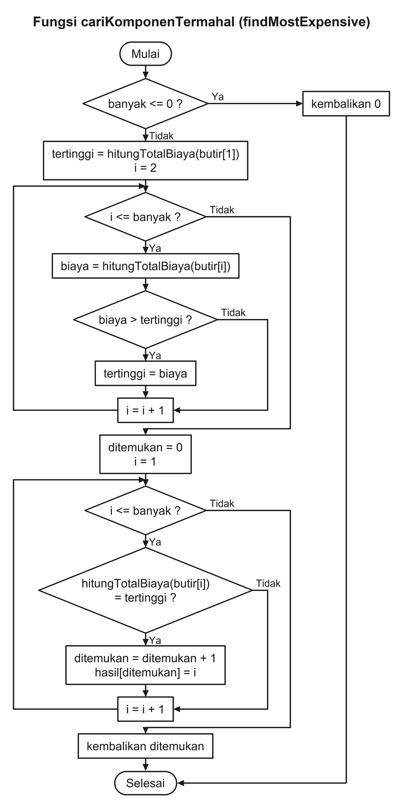
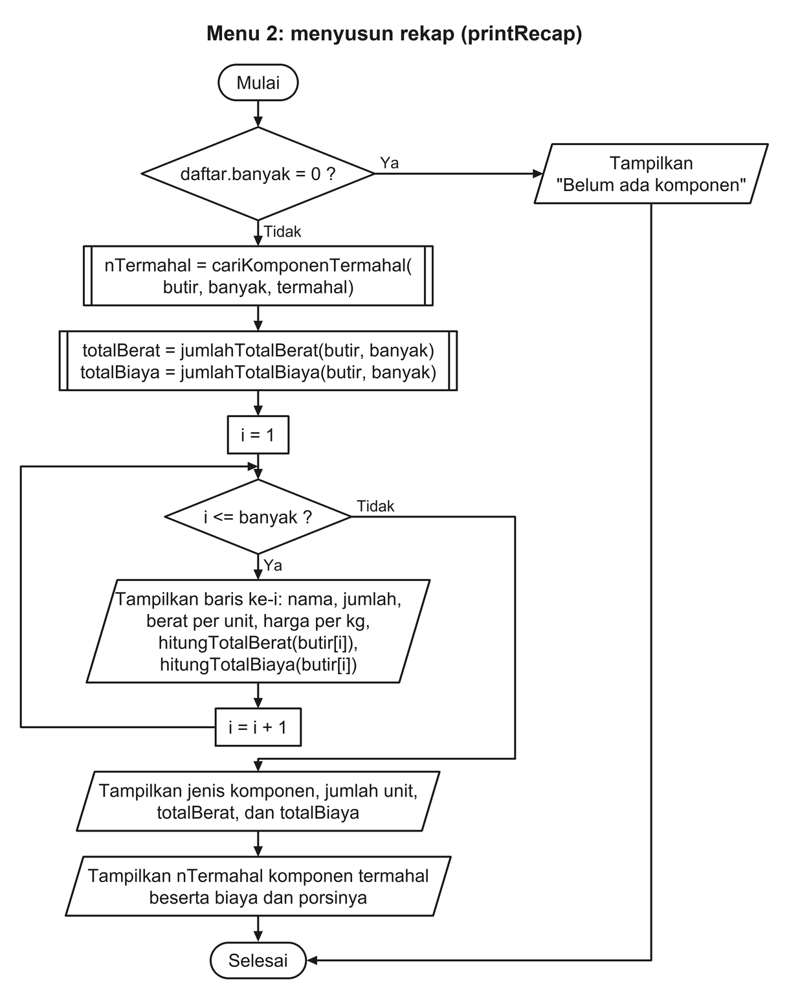

# Flowchart ESTIMA

Flowchart dipecah per bagian supaya tiap gambar tetap terbaca. Nama variabel dan fungsi mengikuti
[pseudocode](pseudocode.md) (larik dinomori mulai 1); nama fungsi C++ yang sepadan ditulis di judul
tiap bagan.

Simbol yang dipakai: bentuk lonjong untuk mulai dan selesai, jajar genjang untuk masukan dan
keluaran, persegi panjang untuk proses (termasuk mengembalikan hasil fungsi), belah ketupat untuk
keputusan, dan persegi panjang bergaris ganda di kedua sisinya untuk langkah yang dikerjakan oleh
fungsi tersendiri. Tidak semua fungsi itu dibuatkan bagan; yang digambar rinci adalah menu 1, menu 2,
pembacaan masukan, dan fungsi-fungsi hitung.

Gambar dibangkitkan dari [`docs/flowchart/charts.py`](flowchart/charts.py) oleh
[`scripts/render_flowcharts.py`](../scripts/render_flowcharts.py) (membutuhkan Pillow):

```bash
python3 scripts/render_flowcharts.py          # menggambar ulang semua bagan
python3 scripts/render_flowcharts.py --check  # gagal bila gambar di repositori sudah usang
```

Di Windows, perintah Python-nya `python`, bukan `python3`.

## 1. Alur utama program

Program menyiapkan daftar kosong, lalu berulang menampilkan menu dan menjalankan pilihan pengguna
sampai pengguna memilih keluar.



## 2. Menu 1: menambah komponen

Satu komponen diisi, diperiksa batas biayanya, ditampilkan ringkasannya, lalu disimpan ke array bila
pengguna setuju. Langkah itu berulang selama pengguna masih ingin menambah.



## 3. Membaca satu masukan sampai sah

Semua pertanyaan memakai pola yang sama: baca, periksa, dan ulangi sampai benar. Contohnya masukan
jumlah.



## 4. Fungsi total berat dan total biaya



## 5. Fungsi mencari komponen termahal

Perulangan pertama mencari nilai biaya tertinggi; perulangan kedua mengumpulkan semua komponen yang
biayanya sama dengan nilai itu, sehingga hasil seri ikut tercatat.



## 6. Menu 2: menyusun rekap


